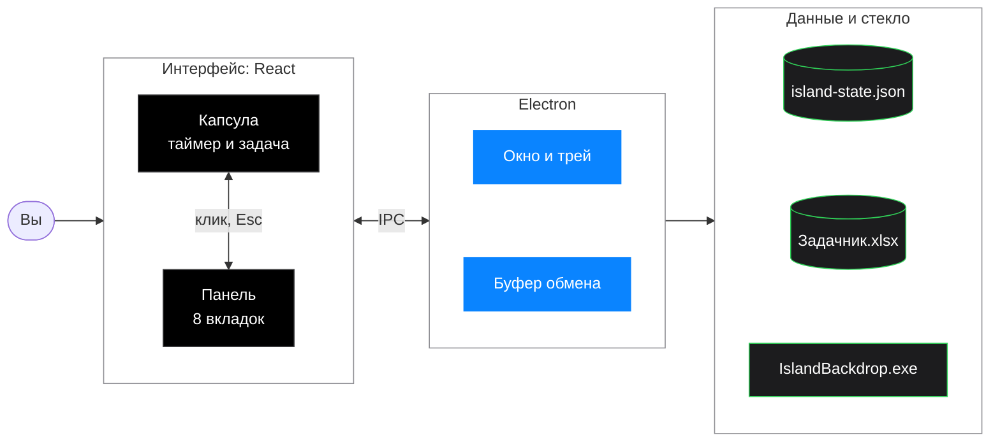

# Island — Dynamic Island для Windows

Чёрный компактный остров поверх окон: задачи, секундомеры, Pomodoro.



Как всё устроено внутри: [блок-схемы работы острова](docs/ARCHITECTURE.md).

## Требования

- Windows 10/11
- Node.js 20+ (LTS)

## Запуск

```bash
cd island
npm install
npm run dev
```

Откроется прозрачное окно-остров у верхнего края экрана.

## Как пользоваться

- **Клик** — панель задач (~560×320)
- **Перетаскивание** — остров магнитится к краям экрана
- **Esc** или кнопка − — свернуть
- У каждой задачи свой **секундомер** (старт / пауза / сброс)
- **Pomodoro** внизу панели привязан к активной задаче: фокус запускает её секундомер
- Подзадачи — в строке задачи
- Выполненная задача зачёркивается

## Bitrix24

Пока заглушка в `src/integrations/bitrix.ts`. На следующем этапе — webhook Bitrix24.

## Сборка

```bash
npm run build
npm run preview
```

Данные хранятся локально в `userData` Electron (`island-state.json`).
