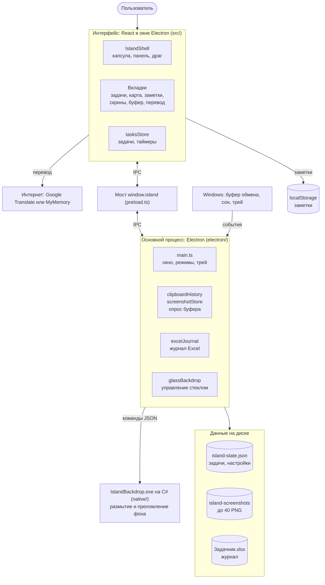
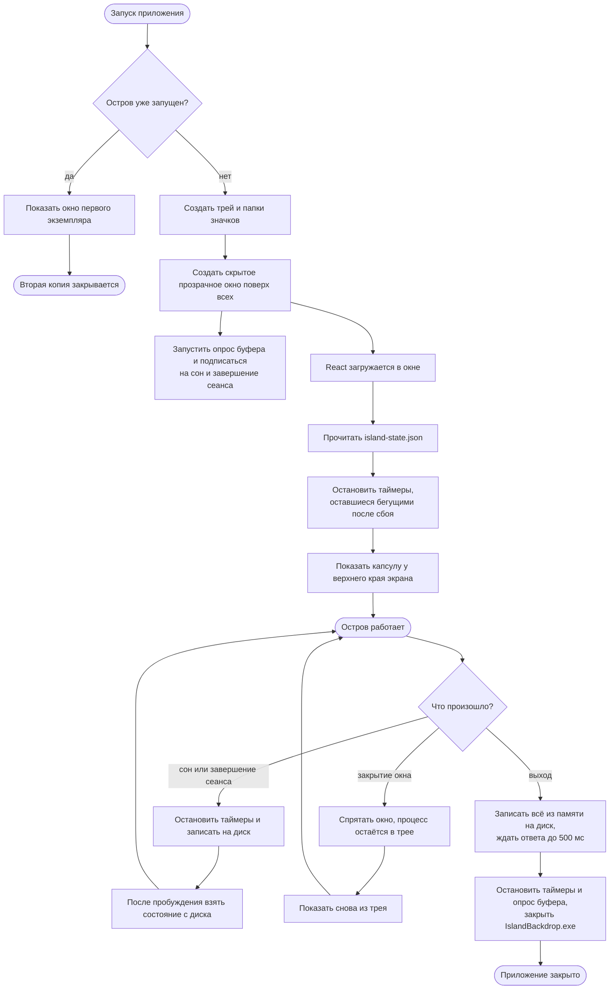
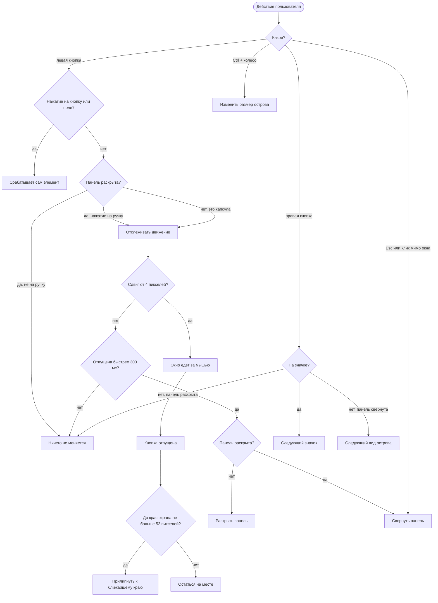
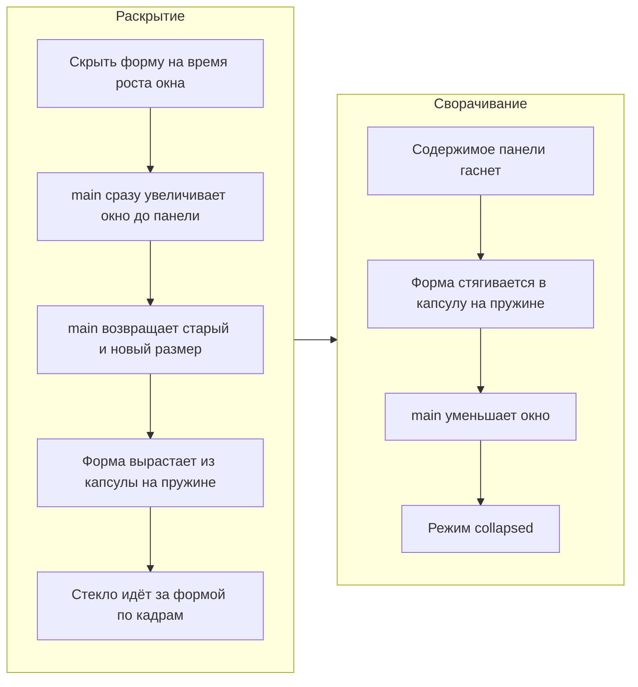
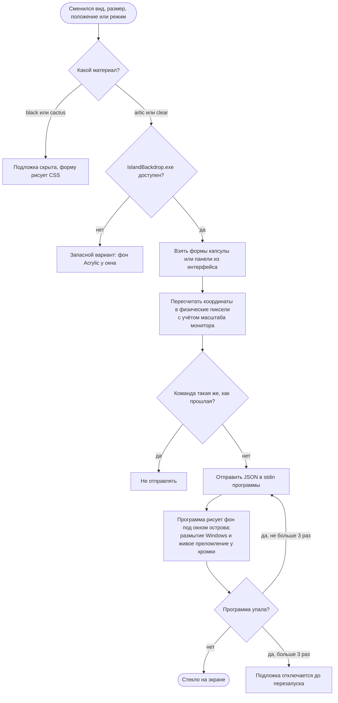
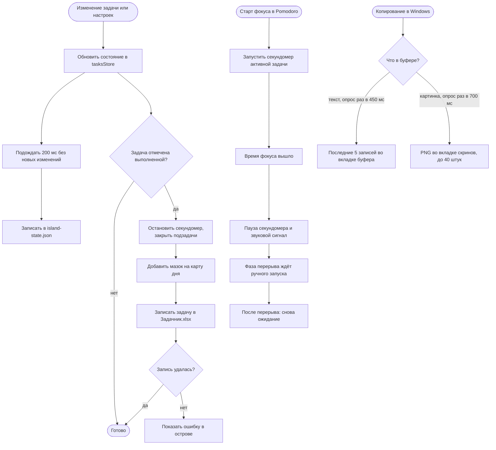

# Как устроен остров

Island — приложение на Electron для Windows. Это маленькое прозрачное окно поверх всех окон. Внутри него React рисует капсулу, панель задач, таймеры и инструменты.

Схемы ниже GitHub рисует сам из текста в формате Mermaid. Править их можно прямо в этом файле.

## 1. Из чего состоит приложение

Приложение разделено на части. Файлами и системой занимается основной процесс, а интерфейс просит его об этом через мост `window.island`. Сам интерфейс делает только две вещи: хранит заметки в `localStorage` и отправляет запросы на перевод.

## 2. Запуск и выход

Если приложение уже запущено, второй запуск не создаёт копию, а показывает окно первой. Закрытие окна только прячет его, полный выход идёт через пункт «Выход» в трее или кнопку в панели.

## 3. Что делает мышь и клавиатура

Клик и перетаскивание различаются по движению и времени нажатия. Движение от 4 пикселей считается перетаскиванием. Нажатие без движения считается кликом, только если оно короче 300 мс. Вид `cactus` к краям не прилипает.

## 4. Как раскрывается и сворачивается панель

Окно меняет размер мгновенно, а плавность создаёт форма внутри него. Поэтому при раскрытии окно сначала вырастает, а при сворачивании уменьшается только после анимации.

Есть три режима окна: `collapsed`, `peek` и `expanded`. Режим `peek` включает только основной процесс при запуске и при показе окна. Интерфейс сам переходит только между `collapsed` и `expanded`.

## 5. Как работает стекло

Окно Electron остаётся прозрачным, а фон рисует отдельная программа `IslandBackdrop.exe`. Она стоит под капсулой и получает её координаты. Вид острова — это пара из материала и раскладки, всего 12 вариантов по кругу.

## 6. Что происходит с задачей и данными

Изменения сразу видны в интерфейсе, а на диск попадают через 200 мс после последнего изменения. Выполненная задача дополнительно записывается в Excel.

## Где что менять

| Что нужно | Файл |
| --- | --- |
| Капсула, панель, анимация, драг | `src/components/IslandShell.tsx` |
| Вкладки панели | `src/components/*Panel.tsx`, `TaskList.tsx`, `EfficiencyMap.tsx` |
| Задачи, таймеры, Pomodoro, сохранение | `src/store/tasksStore.ts` |
| Список видов острова | `src/viewMode.ts` |
| Стили | `src/styles/theme.css` |
| Окно, размеры, края, трей, запуск и выход | `electron/main.ts` |
| Новая команда между интерфейсом и системой | `electron/preload.ts` и обработчик в `electron/main.ts` |
| Журнал Excel | `electron/excelJournal.ts` |
| Буфер и скриншоты | `electron/clipboardHistory.ts`, `electron/screenshotStore.ts` |
| Команды для стекла | `electron/glassBackdrop.ts` |
| Само стекло | `native/IslandBackdrop/Program.cs`, `Refraction.cs` |
| Bitrix24 (пока заглушка) | `src/integrations/bitrix.ts` |

После изменений в `native/IslandBackdrop` нужно собрать программу заново и обновить `native/backdrop`: приложение запускает `IslandBackdrop.exe` оттуда.
